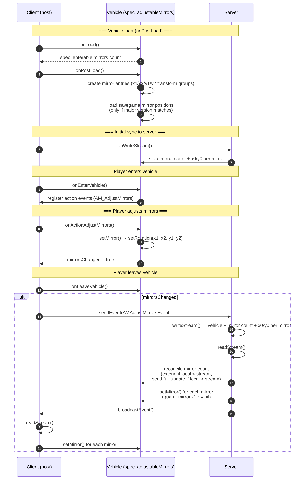

# AdjustableMirrors — Multiplayer Event Flow

Sequence diagram of how mirror data flows between client, server, and the
vehicle object in a listen-server multiplayer session.

## Key behaviors

- **`onWriteStream`** runs when the vehicle is first synced to the server
  (after `onPostLoad`). It writes the mirror count and each mirror's `x0`/`y0`
  so the server has a baseline.
- **`AMAdjustMirrorsEvent`** is only sent on `onLeaveVehicle` if mirrors were
  actually changed. The host's own events go through the full
  `writeStream → readStream → broadcast` cycle on the server side.
- **`readStream` reconciliation** (in `AdjustMirrorsEvent.lua`):
  - Local has *fewer* mirrors than the stream → extend `spec.mirrors` with
    empty tables (dedicated server case), store `x0`/`y0` directly.
  - Local has *more* mirrors than the stream → send a full update event so
    the server gets the complete mirror data.
  - Counts match → apply `setMirror` for each mirror (guarded by
    `mirror.x1 ~= nil`).
- **Savegame version check** only resets mirror data on a *major* version
  change (e.g. `4.x` → `5.x`). Minor/patch bumps preserve the data.
